<div align="center">

# False Five: Who Has the Ball?

**Frame-level ball possession for FC Barcelona vs Athletic Club**<br>
More than a Hack 2027, Phase 1 (Metrica Sports, FC Barcelona Innovation Hub, Mobile World Capital Barcelona)

Farrel Athalla Putra · Izhar Alif Akbar · Raka Daffa Iftikhaar · Kefas Kurnia Jonathan · M. Fithra Rizki

[Technical document (PDF)](docs/False_Five.pdf) · [Notebook](notebooks/false_five_possession.ipynb) · [Submission](submission/False_Five.csv) · [Reproduce in 10 seconds](#7-reproduce-the-submission)

</div>

---

## In short

We label all **199,319 frames** of the match as `H` (Barcelona), `A` (Athletic), `D` (dead ball) or `X` (not graded). The tracking is automatic and uncorrected: the ball is missing on 41% of graded frames and players drop in and out. That is a lot of noise.

Our answer is to **learn possession from 74 fully labelled professional matches**: 7 Bundesliga matches, 3 Metrica matches and 64 World Cup 2022 matches. Every one of them is **degraded with this match's own noise**, so the models train on data that looks like BAR-ATH. Four sequence models read every frame in up to 100 s of context, a greedy ensemble combines them, and a **duration-aware Viterbi decoder** turns the probabilities into clean possessions. Two cues that exist only for this match (broadcast replays and the shape of ball-tracking gaps) feed the decoder's dead-ball state.

| | spellF1 (ranking) | macroF1 (tie-break) |
|---|---|---|
| **False Five, 52 held-out halves from 3 leagues** (honest full-match estimate) | **0.771** | **0.923** |
| **False Five, public 5-minute window** (official scorer) | **0.688** | **0.927** |
| Best official baseline, public window | 0.424 | 0.621 |

The submission is **byte-for-byte reproducible**. Running `python regenerate_submission.py` rebuilds `False_Five.csv` with the identical SHA-256 in about 10 seconds on a laptop CPU.

<p align="center">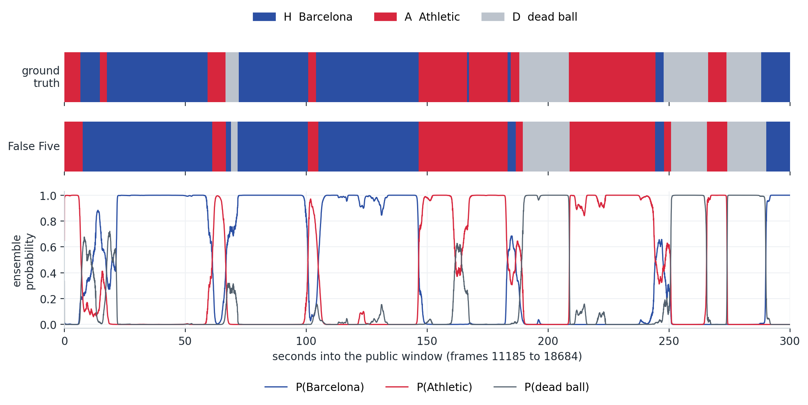</p>

<p align="center"><sub><b>The public five minutes.</b> Top: ground truth. Middle: our submission. Bottom: the ensemble probabilities that the decoder reads. Long possessions, stoppages and quick turnovers line up closely.</sub></p>

---

## Contents

1. [The challenge](#1-the-challenge)
2. [Results](#2-results)
3. [Approach at a glance](#3-approach-at-a-glance)
4. [How it works, step by step](#4-how-it-works-step-by-step)
5. [The possession rules we implement](#5-the-possession-rules-we-implement)
6. [Assets used](#6-assets-used)
7. [Reproduce the submission](#7-reproduce-the-submission)
8. [Repository layout](#8-repository-layout)
9. [Where it can grow next](#9-where-it-can-grow-next)
10. [References](#10-references)

---

## 1. The challenge

For every frame of the tactical video we decide who has the ball. The ranking metric, **spellF1**, treats each possession (a maximal run of `H` or `A`) as one object. Predicted and true possessions are matched one-to-one by temporal IoU, and F1 is averaged over IoU thresholds 0.3 to 0.7:

$$\text{spellF1} = \frac{1}{5}\sum_{\theta \in \{0.3,\dots,0.7\}} \frac{2\,TP_\theta}{2\,TP_\theta + FP_\theta + FN_\theta}$$

Three properties of this metric shaped our design.

* **Every flicker costs twice.** A one-second false switch invents a possession (false positive) and can split a true one below the IoU threshold (false negative). Frame accuracy alone is not enough. The output has to be *segmented* well.
* **Dead balls split possessions.** `H H D D H H` is two possessions. Detecting stoppages matters as much as the team call.
* **Boundaries must be sharp.** A systematic one-second offset costs about 0.35 spellF1 on a typical possession.

And the data is hard.

<p align="center">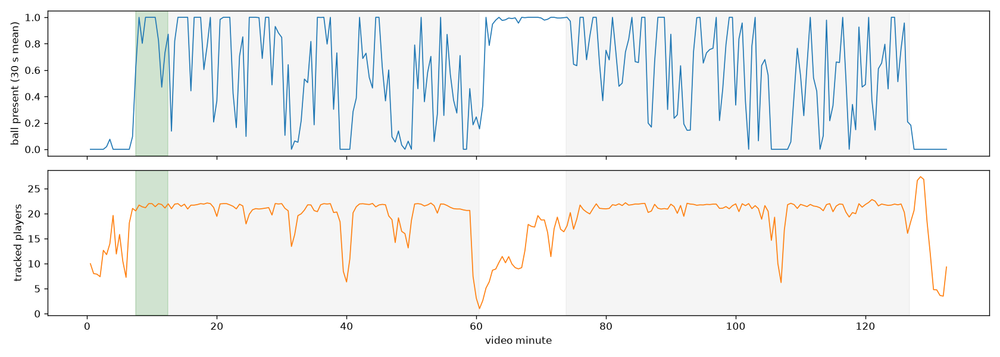</p>

<p align="center"><sub>Share of frames with a tracked ball (30 s mean, top) and number of tracked players (bottom) over the whole video. The green band is the public window. The ball is present on 88% of the public window but on only 59% of all graded frames, and the gaps come in long blocks (median 10.7 s).</sub></p>

---

## 2. Results

### Held-out validation: the number we trust

The public window holds only 17 possessions, so one possession moves its spellF1 by about 0.06. We therefore made every decision on **52 held-out halves from three leagues and three tracking systems**, each degraded with BAR-ATH's own noise. The public window was never used to choose anything.

<p align="center">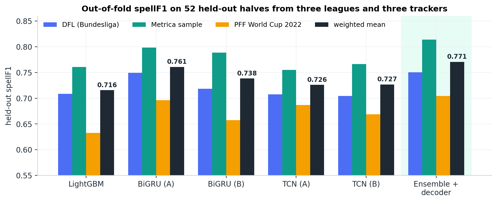</p>

| model | DFL | Metrica | PFF | weighted spellF1 | macroF1 |
|---|---|---|---|---|---|
| LightGBM | 0.709 | 0.761 | 0.633 | 0.716 | 0.901 |
| BiGRU, mixture A | 0.750 | 0.799 | 0.696 | 0.761 | 0.918 |
| BiGRU, mixture B | 0.719 | 0.789 | 0.657 | 0.738 | 0.914 |
| TCN, mixture A | 0.707 | 0.755 | 0.687 | 0.726 | 0.915 |
| TCN, mixture B | 0.705 | 0.766 | 0.669 | 0.727 | 0.912 |
| **Final: ensemble + decoder + evidence** | **0.750** | **0.814** | **0.705** | **0.771** | **0.923** |

The weighted score counts Metrica twice, because Metrica's sample games share the target's tracker and labelling convention. Frame accuracy of the final system on held-out halves is **92.2%**.

<p align="center">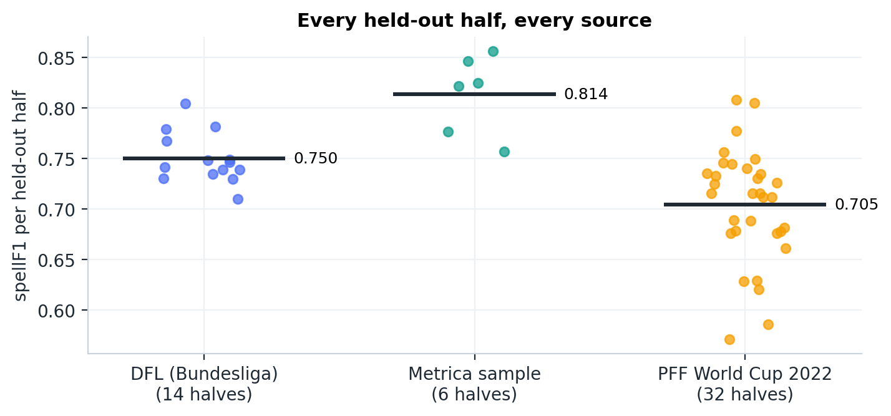</p>

### Public window (official scorer)

```
rank  submission                macroF1  spellF1   poss     dur  transF1  lat_f
   1  False_Five                 0.9267   0.6875     15    16.5   0.5263   +4.1
   2  baseline_smooth125         0.5812   0.4242     16    18.5   0.1667   -7.7
   3  baseline_smooth50          0.6207   0.3256     26    10.8   0.0816   +4.0
   4  baseline_smooth25          0.6200   0.2868     36     7.6   0.2034   +8.2
   5  baseline_raw               0.5972   0.0378    131     2.0   0.1410   -3.1
```

<p align="center">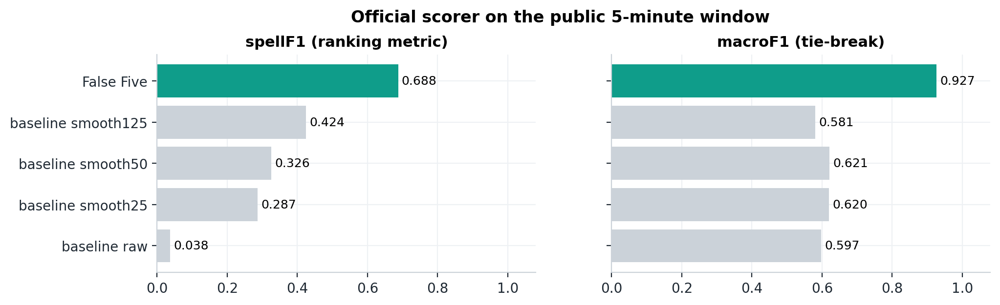</p>

* spellF1 **0.688** (bootstrap 5 to 95%: 0.51 to 0.86), **+62%** over the best baseline. At IoU 0.3 it reaches 0.81.
* macroF1 **0.927**: H 0.948, A 0.925, D 0.907. Frame accuracy 93.3%, Cohen's kappa 0.892.
* Alive vs dead F1 **0.979**. All four stoppages are found.
* 15 predicted possessions vs 17 true, with a median boundary latency of **+2 frames** (0.08 s).

### Full match

<p align="center">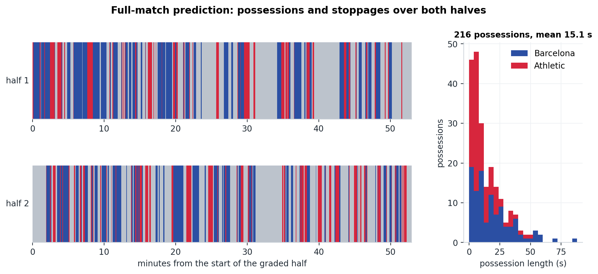</p>

| | prediction | reference |
|---|---|---|
| Possessions | 216 | |
| Possessions per live minute | 3.98 | 4.23 in the public truth, 4.0 to 5.0 in the external labels |
| Mean possession length | 15.1 s | 14.2 s in the public truth |
| Stoppages | 109 | about 87 to 100 per match in the external data |
| Dead-ball share of graded frames | 48.8% | about 50% effective playing time in LaLiga |
| Barcelona share of live ball | 63.4% | |

The possession rhythm, stoppage count and dead-ball share all land where professional football lives. The prediction behaves like a real match, not only on the easy five minutes.

---

## 3. Approach at a glance

<p align="center">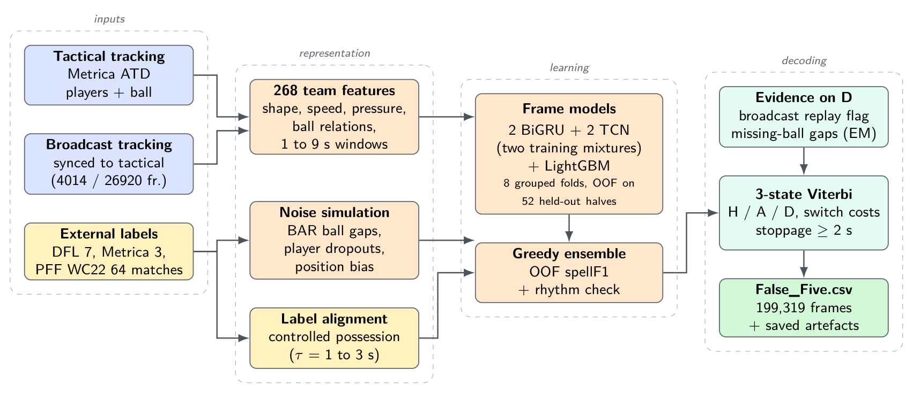</p>

| stage | what it does | why it matters |
|---|---|---|
| **Broadcast sync** | aligns the second (broadcast) tracking to the tactical one with a constant per-half delay | fills 8,049 missing ball frames and gives a replay flag that marks stoppages |
| **External labels** | 74 professional matches with frame-level possession and ball status, aligned to *controlled* possession | thousands of possessions to learn from instead of 17 |
| **Noise simulation** | copies BAR-ATH's exact ball gaps, player dropouts and position bias onto every training half | the models learn in the target's conditions |
| **268 team features** | permutation-invariant team shape, speed, pressure and ball relations over 1 to 9 s windows | robust to the identity swaps of automatic tracking |
| **Sequence models** | 2 BiGRUs and 2 TCNs on two training mixtures, plus LightGBM | context of up to 100 s around every frame |
| **Greedy ensemble** | forward selection with replacement on held-out spellF1 | members with complementary errors |
| **Viterbi decoder** | 3 states, switch costs tuned on held-out spellF1, stoppages of at least 2 s | turns probabilities into clean possessions |
| **Match evidence** | broadcast replays and missing-ball gap length as log-likelihoods on `D` | uses what only this match can tell us, with a built-in cross-check |

---

## 4. How it works, step by step

### 4.1 Reading the match

**Tactical tracking.** Each line of the Metrica ATD holds 46 player slots and the ball in normalised coordinates. Slots are tracklets, not people, so identities swap. We convert everything to metres in a common frame where the home team attacks towards +x. Barcelona attacks right in the first half, so the second half is rotated by 180°.

**The broadcast is the live feed with a delay.** Cross-correlating one-second means of ball x between the two trackings, then refining with a frame-level search, gives a constant lag per half: tactical frame *t* = broadcast frame *t* + 4,014 (first half) and *t* + 26,920 (second half). Where both see the ball, the median distance is 0.8 m. This alignment unlocks two signals.

1. **Ball gap-fill.** Wherever the tactical ball is missing and the broadcast has a reliable homography (reprojection error below 5, no isolated jump above 3 m), we take the broadcast ball. That recovers **8,049 frames**.
2. **Replay flag.** When the broadcast homography is invalid, the director is showing a replay or a close-up. On the public window that happens on **76% of dead-ball frames but only 3 to 4% of live frames**. It is the strongest stoppage cue in the bundle.

### 4.2 Learning from labelled football elsewhere

Five public minutes cannot train a model. Three open sources carry exactly the two quantities the ground truth is made of, a ball status and a team in possession, over full matches.

| source | matches | tracking | possession and dead-ball labels |
|---|---|---|---|
| IDSSE / Sportec DFL (Bundesliga) | 7 | optical, 25 fps, all 22 players | per-frame `BallPossession` and `BallStatus` |
| Metrica Sports sample games | 3 | Metrica's own tracking, 25 fps | from Metrica's event definitions (PASS, CARRY, RECOVERY, BALL OUT, SET PIECE, fouls) |
| PFF FC FIFA World Cup 2022 | 64 | broadcast tracking, 29.97 fps resampled to 25 | from PFF possession sequences, `OUT` events and set-piece restarts |

**Aligning labels to *controlled* possession.** Raw provider labels flip on every touch: DFL changes possession 8.3 times per live minute, about twice the challenge's rhythm. Our alignment `merge_short(labels, tau)` gives a team spell shorter than `tau` back to the previous team when that team regains the ball or play stops right after it, which is a touch without control. With `tau` = 2 s for DFL and Metrica and 1 s for PFF, all three sources land on the rhythm of the public ground truth (4.2 possessions per live minute, median 7.6 s), **without ever tuning on it**.

<p align="center">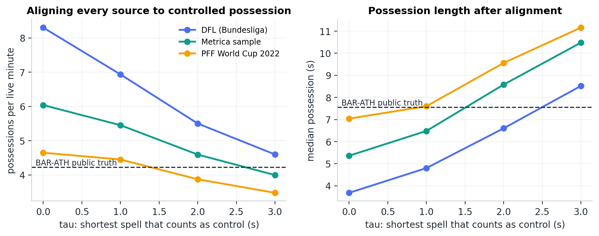</p>

**Source shares.** PFF has 9 times more matches than DFL. To keep any one source from dominating, every source gets a fixed share of the training weight. Mixture A (DFL 35%, Metrica 20%, PFF 45%) is the best all-round mix. Mixture B (DFL 45%, Metrica 40%, PFF 15%) leans towards the target's own tracker and convention. The sequence models are trained on both, and the ensemble decides.

### 4.3 Making external data look like our match

The external tracking is cleaner than Metrica's automatic tracking of BAR-ATH. So every training and validation half is degraded with **BAR-ATH's own noise**.

<p align="center">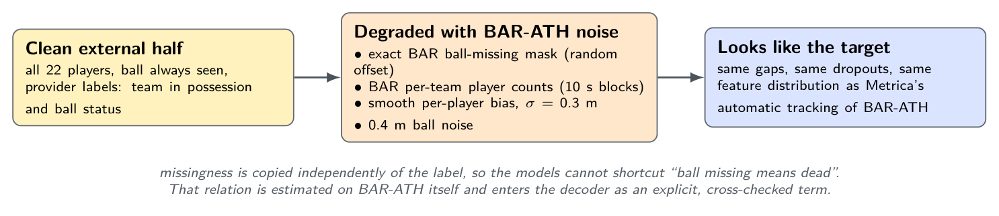</p>

* the **exact ball-missing mask** of BAR-ATH, copied from a random offset, so gap lengths and clustering are real
* the **per-frame number of tracked players** per team, dropped in 10 s blocks
* a **slowly varying position bias** per player (σ = 0.3 m, interpolated every 2 s). Independent per-frame jitter would add fake speed, while a smooth bias keeps speeds realistic.
* 0.4 m of ball noise

The ball mask is copied **independently of the label**. The models therefore cannot learn the shortcut "missing ball means dead ball", whose strength is specific to each tracker. That relation is measured on BAR-ATH itself (section 4.7).

### 4.4 Team-level features

The tracking has no identities, so every one of the **268 features** is team-level and permutation-invariant:

* **shape:** centroid, spread, second-deepest line (goalkeeper excluded), most advanced player, length and width, share of players in each third
* **movement:** mean and max speed, share running (> 4 m/s) and walking (< 1 m/s), velocity along the attacking direction. Speeds are also divided by the sequence's median player speed, so leagues and trackers with different absolute speeds look alike.
* **pressure:** mean distance to the nearest opponent
* **ball relations:** nearest and second-nearest player per team, players within 5 m, ball outside the pitch, ball speed, time since and until the ball was last seen
* **context:** NaN-aware rolling means over centred 1, 3 and 9 s windows and 2 and 6 s past and future windows

Every per-team feature exists for both teams, so swapping home and away is an exact column permutation. We use it to **double the training data** and to stop the models from learning that the home side usually has the ball.

### 4.5 Frame models

| member | architecture | context | training mix |
|---|---|---|---|
| **BiGRU A** (2 seeds) | Linear → GELU → 2-layer bidirectional GRU (hidden 192) → Linear | the whole 102 s chunk | A |
| **BiGRU B** | same | same | B |
| **TCN A** | 6 residual dilated Conv1d blocks (kernel 5, dilations 1 to 32, LayerNorm) | about 50 s centred on the frame | A |
| **TCN B** | same | same | B |
| **LightGBM** | 63 leaves, 300 rounds, deterministic | rolling windows | A |

The sequence models read 5 fps sequences in 512-step chunks and label every step. At prediction time they run on the five 5 fps phases of the 25 fps sequence and interleave the outputs. Inputs are robust-scaled (median and IQR) and trained with Gaussian input noise and the home/away swap.

**Validation protocol.** All DFL and Metrica matches and 16 PFF matches are split into **8 grouped folds**, so each match is held out exactly once. The other 48 PFF matches always train. Every model produces out-of-fold (OOF) predictions on **identical** held-out features, and the BAR-ATH prediction is the average of the 8 fold models. Every probability in the submission therefore comes from a model that was itself validated.

### 4.6 Greedy ensemble selection

With five members a full weight grid is wasteful, so we use **forward selection with replacement** (Caruana et al., 2004). Starting from nothing, each step adds one copy of the member that most improves the held-out spellF1 after decoding.

<p align="center">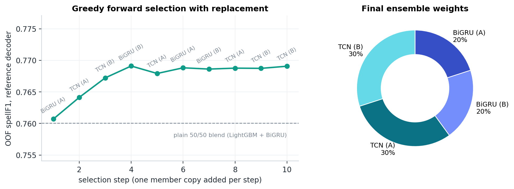</p>

The final ensemble is **BiGRU A 20%, BiGRU B 20%, TCN A 30%, TCN B 30%**. The recurrent and convolutional members make partly independent errors, and the two mixtures add a second view of the labelling convention.

**Rhythm check.** Selection also watches the number of possessions the candidate predicts on BAR-ATH itself, which needs no labels. A small penalty applies only if that rate leaves a ±10% band around the rate of the external labels (4.04 to 4.89 per live minute). The chosen ensemble predicts **4.24** before the evidence terms, comfortably inside the band, so held-out spellF1 alone decided.

### 4.7 Decoding for the metric

<p align="center">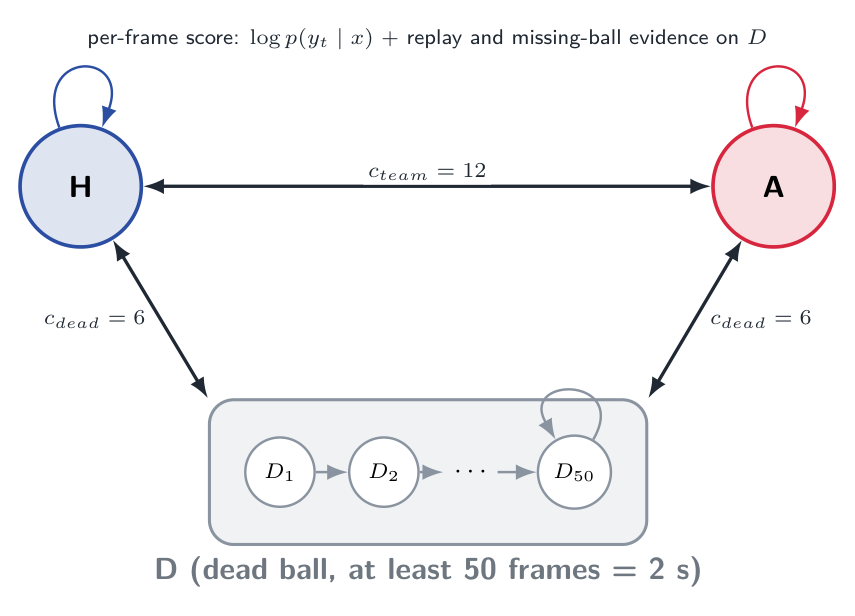</p>

The decoder finds the label sequence that maximises the per-frame log-probabilities minus a cost for every switch:

$$\hat{y} = \arg\max_{y_{1:T}} \sum_t \Big[\log p(y_t \mid x) + e_t(y_t)\Big] - \sum_t c(y_{t-1}, y_t), \qquad \text{every } D \text{ run} \geq 50 \text{ frames}$$

* `c_team = 12` for a direct `H`/`A` switch, `c_dead = 6` to enter or leave a stoppage
* a **minimum stoppage of 2 s**, implemented exactly by expanding `D` into a chain of 50 sub-states (a semi-Markov minimum duration)
* each half decoded separately, ungraded frames set to `X`

All costs are chosen on held-out spellF1 over a 7 × 5 grid. The surface is smooth and flat near the optimum, a sign of a robust choice.

<p align="center">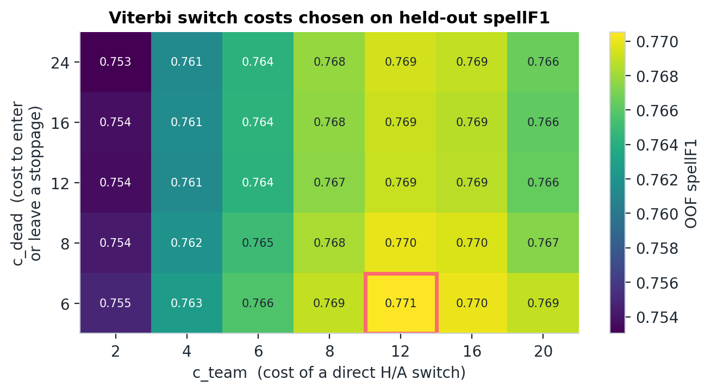</p>

Boundary timing on held-out halves is **unbiased**. Median offsets are within 2 frames (0.08 s) for team changes, stoppages and restarts on all three sources.

<p align="center">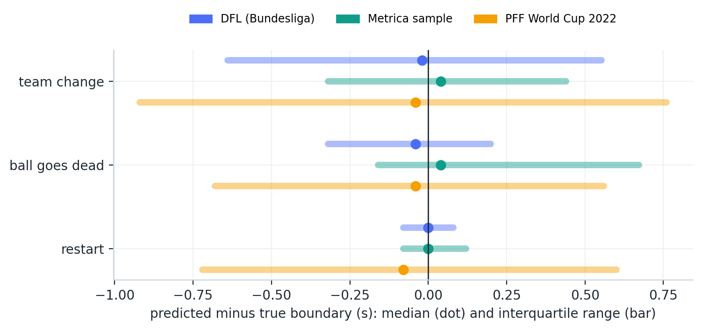</p>

### 4.8 Match-specific evidence on the dead-ball state

Two signals exist only for this match. They enter the decoder as explicit log-likelihood terms `e_t(D)`.

**Broadcast replay.** Under a naive-Bayes view the flag adds `log P(flag | D) − log P(flag | alive)`. The public-window log-ratios are +3.1 (replay) and −1.4 (live picture). We use **half** of each (+1.5 and −0.7) so as not to over-trust four stoppages.

**Missing-ball gaps (one EM step).** Every graded frame gets a gap category: ball visible, or the length of the gap it sits in. The model-only decode supplies dead-ball posteriors, and one expectation-maximisation step turns them into log-ratios per category.

<p align="center">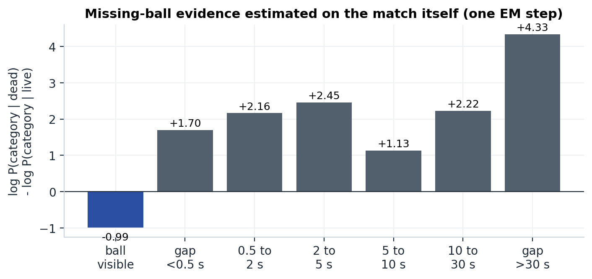</p>

A visible ball argues for live play (−1.0) and gaps longer than 30 s strongly argue for a stoppage (+4.3), just as video spot checks show (drinks breaks, substitutions, goal celebrations). The term is applied at half weight and is **kept only if it improves agreement with the independent replay flag**, which it does (replay log-likelihood −0.465 → −0.459). Each signal referees the other, and neither is tuned on the public window.

---

## 5. The possession rules we implement

<p align="center">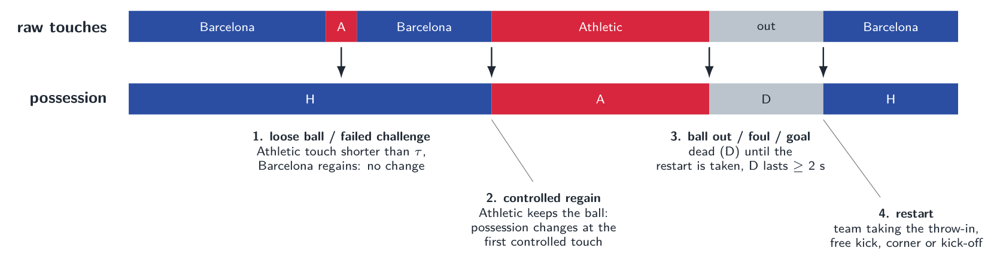</p>

| situation | our rule |
|---|---|
| **Controlled possession** | A team has the ball from its first *controlled* action until the opponent gains control or play stops. A spell shorter than `tau` (2 s for DFL and Metrica labels, 1 s for PFF possession sequences) that ends with the previous team regaining the ball is a touch, not a possession. |
| **Loose balls** | Deflections, blocked passes and balls in the air stay with the last team in control until the opponent establishes control. The decoder's switch cost `c_team` adds the same inertia at prediction time. |
| **Challenges and duels** | A tackle changes possession only when the winning team keeps the ball. A challenge won and immediately lost does not flip possession. |
| **Ball out of play** | Dead (`D`) from the moment the ball leaves the pitch until the restart is taken. |
| **Fouls, offsides, goals, injuries** | Dead from the referee's stoppage until the restart (free kick, kick-off or drop ball). |
| **Restarts** | Throw-in, corner, goal kick, free kick, penalty and kick-off give possession to the team taking them, from the moment the ball is put back in play. |
| **Stoppage length** | A stoppage lasts at least 2 s. Shorter dead stretches are not real football stoppages. |
| **Outside the graded halves** | `X` (warm-up, half-time, after the final whistle). |

These rules come from the label sources themselves (DFL `BallStatus`, Metrica's event definitions, PFF `OUT` events and set-piece types), aligned to one shared notion of control.

---

## 6. Assets used

| asset | used | how |
|---|---|---|
| Tactical ATD (players and ball) | ✅ | all 268 features |
| Tactical metadata XML | ✅ | team of each slot, attack direction |
| Broadcast ATD + homography | ✅ | ball gap-fill (8,049 frames) and the replay flag |
| Public 5-minute ground truth | ✅ | reporting and the replay log-ratios only, never model or decoder selection |
| Official scorer and validator | ✅ | all metrics and the final format check |
| IDSSE / Sportec DFL open data | ✅ | training and validation (CC-BY 4.0) |
| Metrica Sports sample data | ✅ | training and validation, closest proxy for the target |
| PFF FC World Cup 2022 | ✅ | training (64 matches) and validation (16 matches), free after registration with PFF FC |
| Smart Tagging | ➖ | left out: its fixed-length windows agree with the public truth on only about 70% of live frames, so it would add noise where the tracking is uncertain |
| Tactical video pixels | ➖ | left out: the tracking already summarises the video, and the broadcast replay flag captures the stoppage signal cheaply |

No private ground truth, no hand labelling and no manual correction of any output. Every label in the submission comes out of the algorithm in this repository.

---

## 7. Reproduce the submission

### Option A: byte-exact regeneration (10 seconds, CPU)

The last step of the pipeline, the Viterbi decode, is deterministic. The notebook saves its three inputs in `artifacts/`:

| file | content |
|---|---|
| `final_probabilities.npy` | ensemble probabilities, 199,319 × 3, float32 |
| `decoder_evidence.npy` | replay + missing-ball log-likelihood on `D`, float32 |
| `decoder.json` | `c_team`, `c_dead`, `min_dead`, graded halves |

```bash
pip install -r requirements-regenerate.txt
python regenerate_submission.py
```

```
wrote False_Five_regenerated.csv  (199319 rows)
sha256 427dc39b0fafc4c950ce4de7fd210dd26219429d964ba5aa631743badb2d3581
byte-identical to False_Five.csv: True
```

Verified on two machines: the Linux GPU box that trained the models and a Windows laptop.

### Option B: the full pipeline from raw data

```bash
git clone https://github.com/farrelathalla/False-Five---More-Than-A-Hack-2027.git
cd False-Five---More-Than-A-Hack-2027
pip install -r requirements.txt

# point the notebook at local copies of the data (no download needed)
export MTAH_DATA_DIR=/path/to/data            # contains tactical/ and broadcast/ from the challenge bundle
export MTAH_REF_DIR=/path/to/reference        # contains pysport/ (DFL), metrica/ and fifa/ (PFF)
export MTAH_REPO_DIR=/path/to/more-than-a-hack-2027

jupyter nbconvert --to notebook --execute --ExecutePreprocessor.timeout=-1 \
    notebooks/false_five_possession.ipynb --output executed.ipynb
```

* DFL is fetched automatically from Hugging Face (`pysport/idsse-data`) if missing, the Metrica sample data from GitHub, and the official scorer from the challenge repository. PFF FC data is free after registration at PFF FC.
* Alternatively, set `MTAH_GDRIVE_DATA` and `MTAH_GDRIVE_REFERENCE` to links of zipped folders.
* The reference run used **one NVIDIA RTX 5090 (32 GB)**, Python 3.12, PyTorch 2.11 (CUDA 12.8), LightGBM 4.6 and NumPy 2.2. It takes about **4 to 5 hours** and peaks at about 20 GB of RAM. Set `MTAH_TINY=1` first for a few-minute code-path test.
* Outputs land in `mtah_work/outputs/`: the CSV, the three artefacts above, `regenerate_submission.py`, `evaluation/report.json` and all figures. The notebook re-runs the regeneration itself and asserts that the output is byte-identical.
* Seeds are fixed, LightGBM is deterministic and PyTorch runs in deterministic mode. GPU kernels can still differ in the last bits across hardware, which is exactly why Option A ships the decoder inputs.

### Validate

```bash
python /path/to/more-than-a-hack-2027/evaluation/validate_submission.py submission/False_Five.csv
python /path/to/more-than-a-hack-2027/evaluation/run_evaluation.py   # public-window score
```

To redraw every figure in this README from the saved results: `python scripts/make_figures.py`.

---

## 8. Repository layout

```
.
├── README.md                       this file
├── regenerate_submission.py        byte-exact rebuild of the CSV from artifacts/
├── requirements.txt                full pipeline
├── requirements-regenerate.txt     regeneration only (numpy, numba)
├── notebooks/
│   └── false_five_possession.ipynb the full pipeline, executed, with all outputs
├── artifacts/                      decoder inputs saved by the notebook
├── submission/
│   └── False_Five.csv              the submitted file
├── results/                        report.json and every evaluation table of the run
├── figures/                        all figures in this README
├── docs/
│   ├── False_Five.tex / .pdf       technical document
│   └── diagrams/                   TikZ sources of the diagrams
└── scripts/
    └── make_figures.py             redraws figures/ from results/ and artifacts/
```

`results/` holds, among others, `model_oof.csv` (every member per source), `ensemble_selection.csv` (the greedy path), `decoder_grid.csv`, `oof_per_half.csv`, `boundary_offsets.csv`, `match_evidence.csv` and `official_scoreboard_public.txt`.

**No match data is included.** The challenge data is licensed for the competition only, and `.gitignore` excludes `data/`, `reference/` and every cache. The saved probabilities and evidence are model outputs and cannot reconstruct the tracking.

---

## 9. Where it can grow next

* **Labels in the target's own convention.** Our external labels come from events (Metrica, PFF) or from another provider's tracking (DFL). A few labelled matches of Metrica's corrected tracking would let the models learn the exact definition of control directly.
* **Ball detection from the video.** A football ball detector on the 1080p tactical frames could recover live-play gaps that both trackings miss, which is where most remaining uncertainty lives.
* **Player-level sequence models.** A set transformer per frame (permutation-invariant over players) feeding the temporal models, trained end to end with a CRF over H/A/D.
* **Learned gap evidence.** Simulating ball gaps conditionally on the label, calibrated on BAR-ATH, would let the frame models use gap context directly instead of through a separate term.

Every one of these plugs into the same validated pipeline. The held-out protocol tells us immediately whether it helps.

---

## 10. References

1. R. Caruana, A. Niculescu-Mizil, G. Crew, A. Ksikes. *Ensemble selection from libraries of models.* ICML 2004.
2. S. Bai, J. Z. Kolter, V. Koltun. *An empirical evaluation of generic convolutional and recurrent networks for sequence modeling.* arXiv:1803.01271, 2018.
3. K. Cho et al. *Learning phrase representations using RNN encoder-decoder for statistical machine translation.* EMNLP 2014.
4. G. Ke et al. *LightGBM: a highly efficient gradient boosting decision tree.* NeurIPS 2017.
5. A. Viterbi. *Error bounds for convolutional codes and an asymptotically optimum decoding algorithm.* IEEE Trans. Information Theory, 1967.
6. D. Link, M. Hoernig. *Individual ball possession in soccer.* PLoS ONE 12(7), 2017.
7. M. Borghesi et al. Temporal convolutional networks for team possession and ball status estimation. Expert Systems with Applications 223, 119780, 2023.
8. H. Kim et al. *PathCRF*, ball-free possession inference from player trajectories with a CRF and Viterbi decoding. arXiv:2602.12080, KDD 2026.
9. Bassek, M., Rein, R., Weber, H., Memmert, D. *An integrated dataset of spatiotemporal and event data in elite soccer* (IDSSE / Sportec DFL open data). Scientific Data, 2025.
10. Metrica Sports sample data: github.com/metrica-sports/sample-data. PFF FC FIFA World Cup 2022 data: pff.com.

<div align="center"><sub>Built by False Five for More than a Hack 2027. Code under the MIT licence. Match data remains the property of its owners and is not distributed here.</sub></div>
